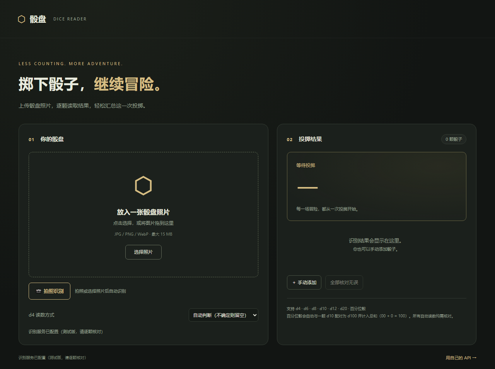
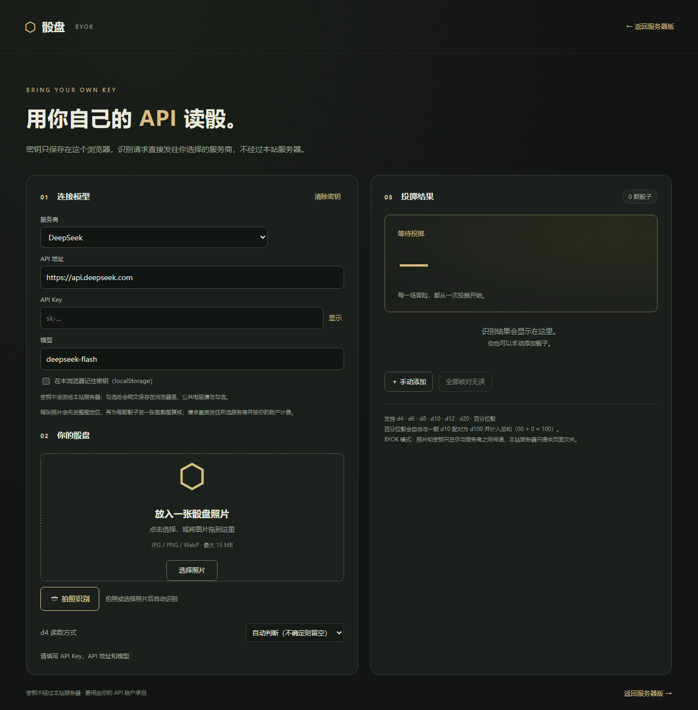

# 骰盘 · D&D Dice Reader

[](https://github.com/c18556210950-art/dice-reader/actions/workflows/tests.yml)

用一张俯拍照片读取 D&D 骰盘上的每颗骰子，自动识别骰型与结果面，最后汇总总和。

项目包含两条独立路径：

1. **在线识别**：FastAPI 后端 + 网页。服务器版调用 DeepSeek 视觉模型；BYOK 版让用户用自己的 API Key，请求直接从浏览器发往服务商。
2. **本地训练**：YOLO11n 检测骰型与位置 + ResNet18 分类印刷点数，配套标注台、数据导出、训练与评估脚本。训练产物不会自动替换线上模型。





## 在线识别

### 功能

- 支持 d4 / d6 / d8 / d10 / d12 / d20 和百分位十位骰 d00。
- 上传或拍照后自动识别，无需再点“识别”按钮。
- 两阶段读数：整图定位 → 按 bbox 裁出单颗骰子并发复核。
- 百分位骰自动与最近的一颗 d10 配对为 d100（`00 + 0 = 100`），配对的两颗不重复求和。
- 每颗骰子都可手动改类型、改读数、移除或补充；结果始终需要人工核对。
- 图片最长边缩放到 1600px，支持 JPG / PNG / WebP，最大 15MB。
- 同一 IP 默认每分钟最多 10 次识别请求。

### 快速开始（服务器版）

需要 Python 3.10+。

```powershell
python -m venv .venv
.venv\Scripts\Activate.ps1
pip install -r requirements.txt
$env:DICE_PROVIDER = "deepseek"
$env:DEEPSEEK_API_KEY = "sk-..."
uvicorn app:app --host 127.0.0.1 --port 8765
```

打开 <http://127.0.0.1:8765/>。

Linux / macOS：

```bash
python3 -m venv .venv
source .venv/bin/activate
pip install -r requirements.txt
export DICE_PROVIDER=deepseek
export DEEPSEEK_API_KEY=sk-...
uvicorn app:app --host 127.0.0.1 --port 8765
```

### 自带 API（BYOK）

打开 <http://127.0.0.1:8765/static/byok.html>，也可以从主页页脚进入。

- 预置 DeepSeek、OpenAI、Anthropic Claude、Google Gemini、OpenRouter、Moonshot / Kimi、阿里云百炼 Qwen，以及自定义 OpenAI 兼容地址。
- 模型名可手动编辑。
- 密钥默认只存 `sessionStorage`；勾选“记住”后存 `localStorage`，按服务商分别保存，可一键清除。
- 页面不调用本站 `/api`，不把密钥或照片发给本站服务器。
- 浏览器直连要求服务商允许 CORS。智谱 GLM 等只允许自家 Origin 的服务未列入。

### 本地模型模式（可选）

不设置 `DICE_PROVIDER` 时使用本地 Ollama，默认请求 `http://127.0.0.1:11435` 上的 `qwen3-vl:4b`：

```bash
DICE_PROVIDER=local uvicorn app:app --port 8765
```

这条路径为独立端口上的本地推理服务准备，模型需要自行下载。没有本地服务时页面仍可打开并手动录入。

### 配置

| 环境变量 | 默认 | 说明 |
| --- | --- | --- |
| `DICE_PROVIDER` | `local` | `local` 或 `deepseek` |
| `DEEPSEEK_API_KEY` | 空 | DeepSeek 服务端密钥，仅服务器版使用 |
| `DICE_DEEPSEEK_THINKING` | `disabled` | 设为 `enabled` 开启思考模式 |
| `DICE_DEEPSEEK_REFINE` | `1` | `0` 关闭逐颗裁剪复核 |
| `DICE_DEEPSEEK_WORKERS` | `6` | 并发复核数，1–12 |
| `DICE_RATE_MAX` | `10` | 每个 IP 在窗口内最多识别次数 |
| `DICE_RATE_WINDOW` | `60` | 限流窗口秒数 |
| `DICE_SERVER_MODE` | 空 | 设为 `1` 时使用服务器部署提示文案 |
| `DICE_PUBLIC_ORIGIN` | 空 | 允许的跨站 Origin，例如 `https://example.com` |

### 部署与安全

应用默认只监听 `127.0.0.1`，建议放在反向代理后面。反向代理需要覆盖 `X-Real-IP` 和 `X-Forwarded-For`，否则所有请求会被当成同一个 IP：

```nginx
location /dice/ {
    client_max_body_size 22m;
    proxy_pass http://127.0.0.1:8765/;
    proxy_set_header Host 127.0.0.1:8765;
    proxy_set_header X-Real-IP $remote_addr;
    proxy_set_header X-Forwarded-For $remote_addr;
    proxy_set_header X-Forwarded-Proto $scheme;
    proxy_read_timeout 330s;
}
```

- 项目本身**没有登录**。放到公网前请自行加 Basic Auth、IP 白名单或单点登录。
- 服务器版 Key 只从环境变量读取，不写入前端、日志或接口响应。
- 服务器版会把照片转发给所选模型服务商；应用不会主动保存照片、识别历史或密钥。
- BYOK 页面的 Key 只存在浏览器，请求直达服务商；页面本身是静态文件。
- BYOK 的 `localStorage` 是明文，公共电脑不要勾选“记住”。
- 内置限流是单进程内存计数；多进程或多实例部署需要外部限流。

## 本地训练流水线

训练代码在 [`training/`](training/README.md)，详细步骤、数据来源、划分方式和评估命令见该目录的 README。流程：

```text
整图 → YOLO11n 检测骰子类型与位置 → 裁出单颗 → ResNet18 分类点数 → 低置信度要求复核
```

安装额外依赖（需要与本机显卡匹配的 PyTorch）：

```bash
pip install -r requirements-training.txt
```

常用命令：

```powershell
python -m training.fetch_dataset
python -m training.annotate
python -m training.workflow --smoke --skip-download
```

Windows 下也可以双击 `启动标注台.cmd`、`训练骰子模型.cmd`。图片、标注、导出、权重和日志都放在 `.runtime/dice-training`，不会进入 Git，也不会上传。

数据来源、许可和当前限制见 [数据集清单](数据集清单.md) 与 [训练说明](training/README.md)。

## 测试

在线识别的单元测试：

```bash
pip install -r requirements-dev.txt
python -m unittest discover -s tests -p "test_app.py" -v
python -m unittest discover -s tests -p "test_deepseek.py" -v
```

训练相关测试需要安装 `requirements-training.txt` 后再运行。测试使用模拟模型响应，不代表真实图像识别准确率。

## 已知限制

- 在线识别是通用视觉模型 + 确定性裁剪，不是专门训练的骰子检测器。复杂光照、严重遮挡、重叠骰子仍可能漏检或读错。
- d4 的顶读/底读本身存在约定歧义，`auto` 模式下可能留空或落在不同面，必须人工核对。
- 6/9 方向不明确、骰子歪斜或上表面被遮挡时，模型会按要求返回 null。
- DeepSeek 视觉接口对整图有较小的图片 token 预算，因此用裁剪复核而不是单纯放大原图。
- BYOK 依赖服务商 CORS；不开放浏览器直连的服务无法使用。
- 训练数据有限，跨设备、字体、光照的效果需要用自己的骰盘照片验证；训练产物不会自动上线。

## 项目结构

```text
app.py                 FastAPI 路由、图片处理、两阶段识别、限流
deepseek_client.py     DeepSeek Chat Completions 适配器
static/index.html      服务器版页面
static/byok.html       自带 API 页面
static/app.js          服务器版交互
static/byok.js         BYOK 交互与浏览器直连适配器
static/pairing.js      百分位骰配对
tests/                 在线识别与训练流水线测试
training/              标注台、数据集、YOLO 检测、分类器、评估
docs/design.md         两阶段识别与 BYOK 的设计说明
docs/*.png             README 截图
```

## License

[MIT](LICENSE)
